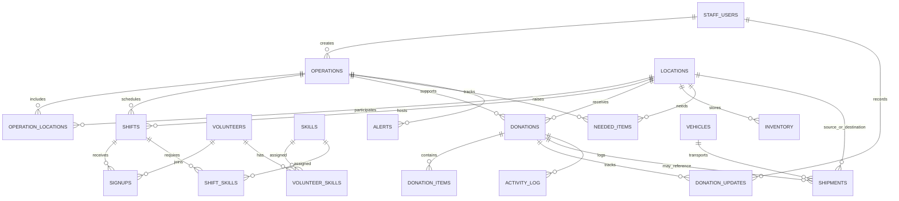

# ReliefTrack data model

The diagram focuses on operational relationships. SQL types and nullability are authoritative in `src/database/schema.sql`; runtime-compatible additions are also managed by `scripts/migrate.sql`.

| Table | Primary fields and meaning |
| --- | --- |
| `staff_users` | Staff identity, email, password hash, role, and active status. |
| `operations` | Response name/type/status/dates and planned `volunteers_needed` target. |
| `locations` | Relief hubs/areas, addresses, coordinates, type, optional contact/operator/photo/feedback metadata. `operation_id` is a legacy one-to-many link; `operation_locations` is the many-to-many membership source. |
| `operation_locations` | Composite key `(operation_id, location_id)` linking operations and hubs; both foreign keys cascade on delete. |
| `volunteers` | Volunteer identity, contact/emergency contact, credential details, and account status. |
| `skills` | Shared volunteer/shift skill catalogue. |
| `volunteer_skills` | Composite relationship represented by a unique volunteer/skill pair and skill level. |
| `shift_skills` | Composite key linking each shift to required skills. |
| `shifts` | Operation/location, date/time, capacity, and status. |
| `signups` | Volunteer/shift attendance, approval state, `check_in`, and `check_out`. Unique per volunteer/shift. |
| `login_codes` | Hashed single-use volunteer OTP, expiry, used state, attempt counter, request IP, and timestamp. |
| `donations` | Donor details, cash/goods/mixed type, operation/location, preference, stage, and timestamp. References are derived as `RT-` plus a zero-padded donation ID. |
| `donation_items` | Item/category/quantity/unit rows for a donation. |
| `donation_updates` | Donation stage history, message, actor, and timestamp. |
| `inventory` | Current stock quantity/unit/minimum/status per location. |
| `needed_items` | Required and received quantity, priority/status, operation, and location. |
| `vehicles` | Vehicle identity, plate, capacity, driver, and availability. |
| `shipments` | Donation/operation/vehicle and source/destination location references with logistics state. |
| `activity_log` | Staff/system event history. |
| `alerts` | Operational alert type, priority, message, read state, and optional staff/operation references. |
| `api_rate_limits` | Hashed request identities by endpoint and timestamp; used for bounded public lookups. |
